<p align="center"></p>
<h1 align="center">Pocket Devices</h1>
<p align="center">Your own hardware in one place: clocks, climate and air-quality sensors, buttons, door, motion and leak sensors, smart plugs. Add a device, paste three lines into its console, and from then on you change its settings here, see what it measures, get an alert when something is wrong (water under the sink, stuffy air, a door left open, a battery running low), and every button press or door opening reaches the rest of your Pocket apps. The device always calls in (it can sit behind NAT); the server never reaches out. Each kind of hardware is one data file, so the next one needs no new code.<br>One Go binary, one SQLite file, one volume. Part of the Pocket apps; works on its own too.</p>
<p align="center">
  <a href="https://github.com/abjelosevic88/pocket-homelab-devices/actions"></a>
  <a href="https://github.com/abjelosevic88/pocket-homelab-devices/pkgs/container/pocket-homelab-devices"></a>
  <a href="LICENSE"></a>
</p>

---

<p align="center">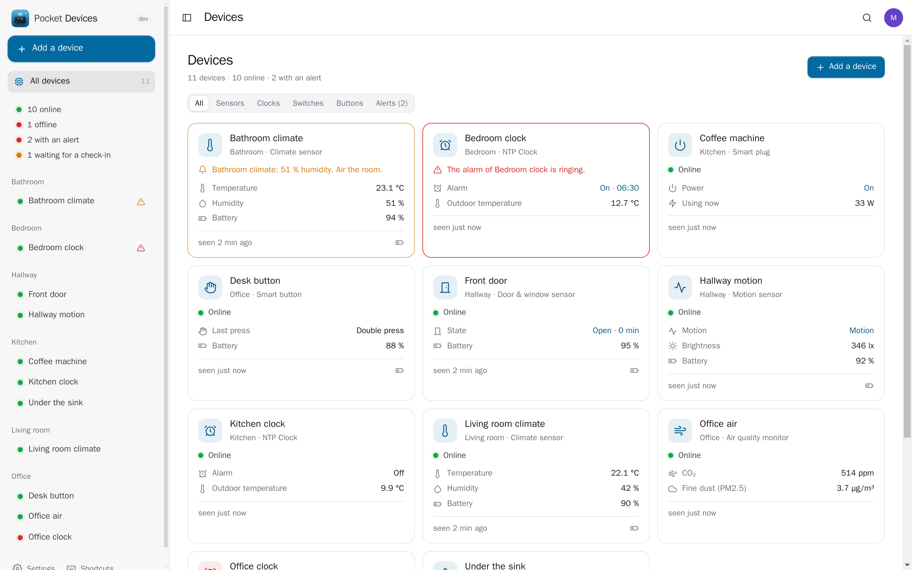</p>

<table>
  <tr>
    <td width="50%">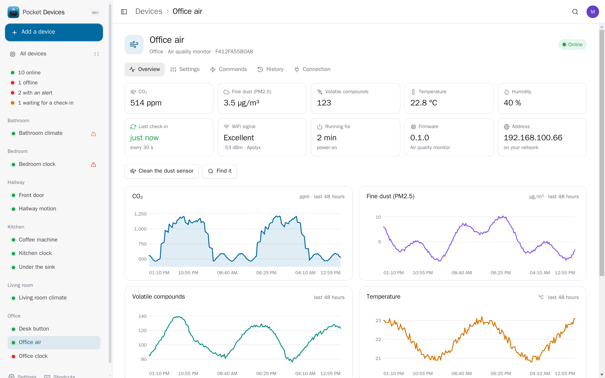</td>
    <td width="50%">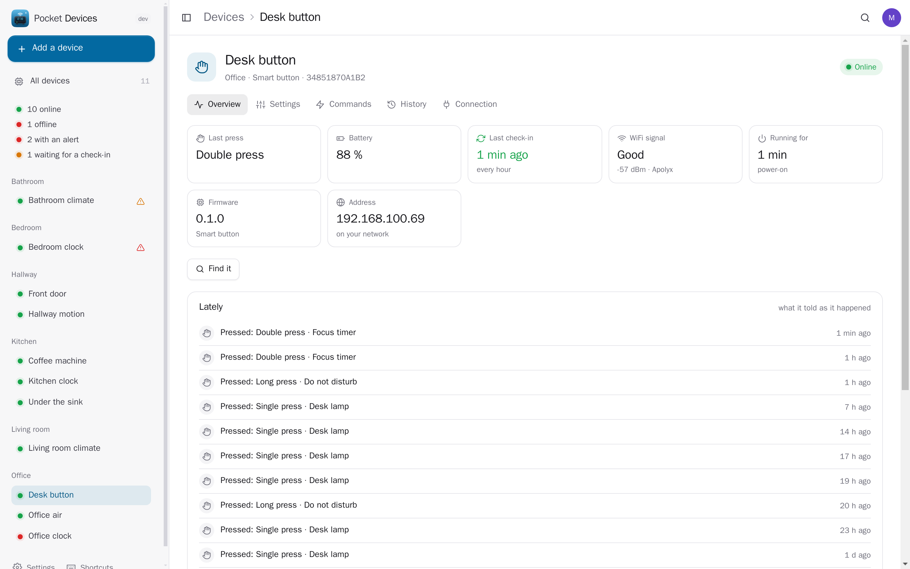</td>
  </tr>
  <tr>
    <td align="center"><sub>Every reading a kind declares, with two days of history.</sub></td>
    <td align="center"><sub>Buttons, doors and motion tell events as they happen.</sub></td>
  </tr>
  <tr>
    <td width="50%">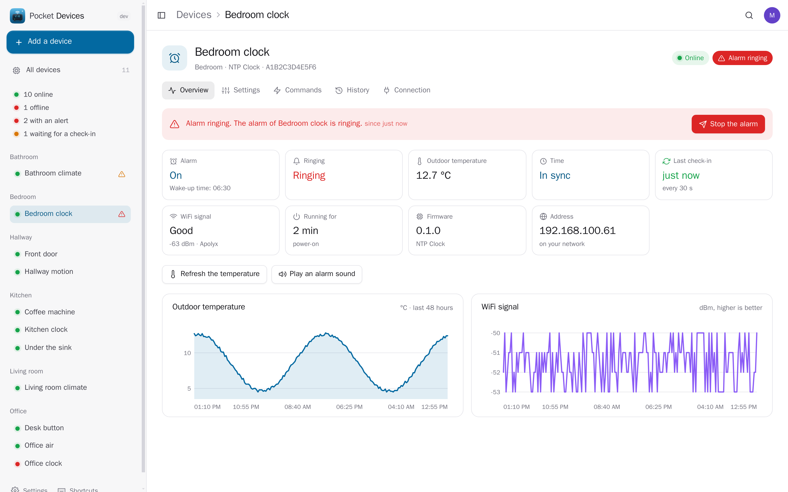</td>
    <td width="50%">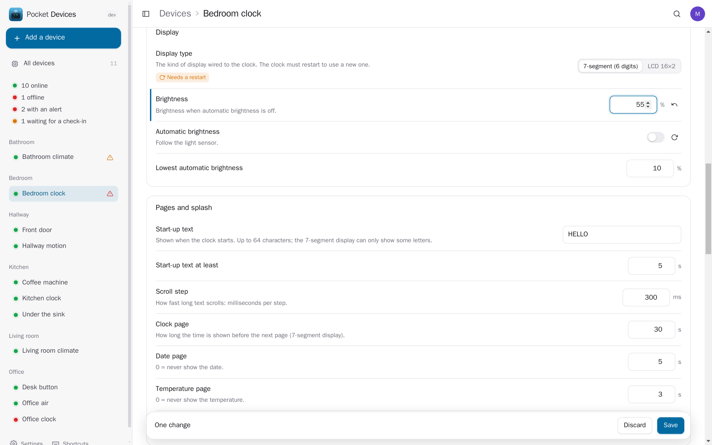</td>
  </tr>
  <tr>
    <td align="center"><sub>Alerts with what to do about them (here: stop the alarm).</sub></td>
    <td align="center"><sub>Every setting with its own control, range, help and "back to default"; restarts are marked.</sub></td>
  </tr>
  <tr>
    <td width="50%">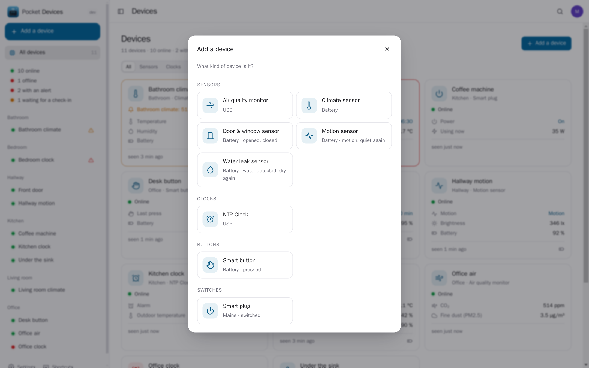</td>
    <td width="50%">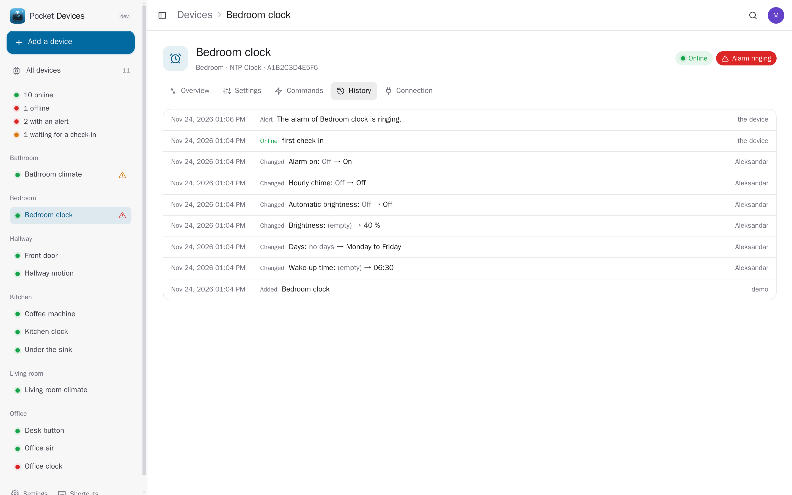</td>
  </tr>
  <tr>
    <td align="center"><sub>Eight kinds of hardware to start with; a new one is a JSON file.</sub></td>
    <td align="center"><sub>History: changes here and at the device, alerts, refusals, commands.</sub></td>
  </tr>
  <tr>
    <td width="50%">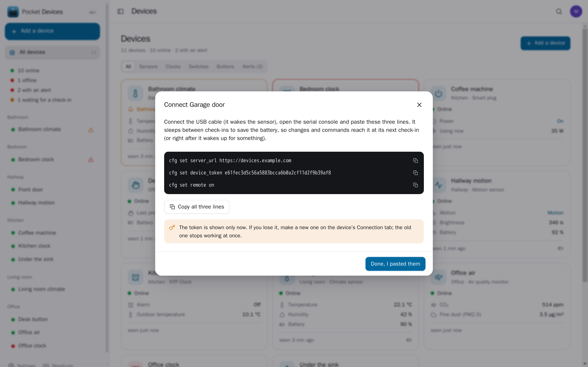</td>
    <td width="50%">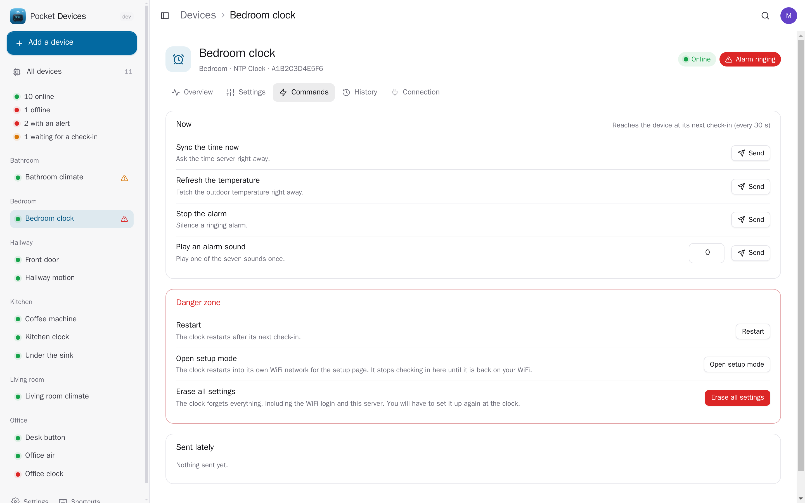</td>
  </tr>
  <tr>
    <td align="center"><sub>Add a device: the token is shown once, with the exact console lines.</sub></td>
    <td align="center"><sub>Commands now, a danger zone that asks (erasing asks twice), and their state.</sub></td>
  </tr>
  <tr>
    <td width="50%">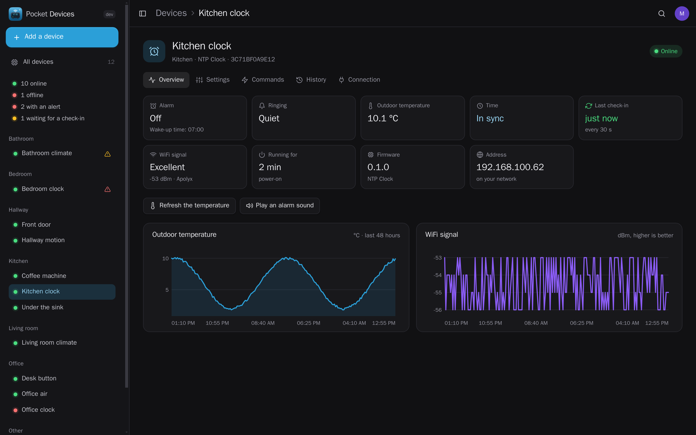</td>
    <td width="50%"></td>
  </tr>
  <tr>
    <td align="center"><sub>Light and dark follow the system.</sub></td>
    <td></td>
  </tr>
</table>

<p align="center">
  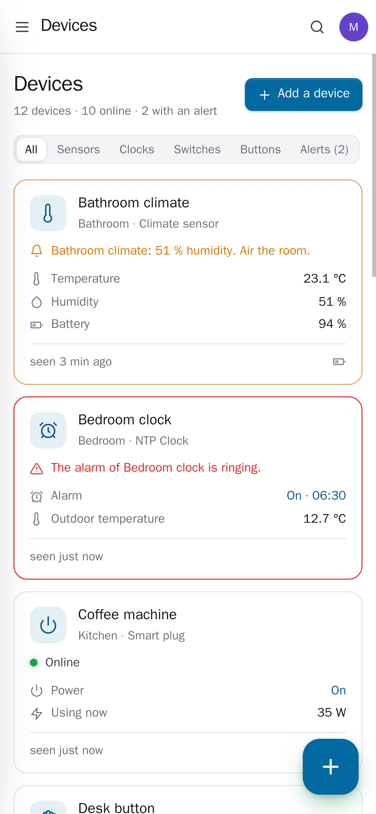&nbsp;&nbsp;
  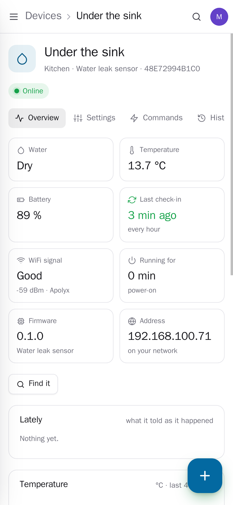&nbsp;&nbsp;
  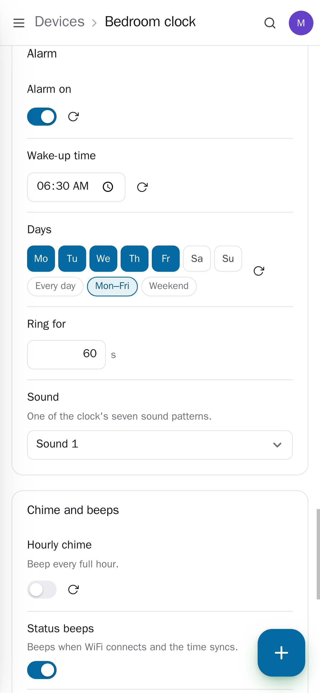
</p>

## What it does

**Kinds of hardware to start with** (an ESP32 each; [docs/protocol.md](docs/protocol.md) has what each reports):
NTP Clock · Climate sensor · Air quality monitor · Smart button · Door & window sensor · Motion sensor · Smart plug · Water leak sensor.

- **Add and connect**: pick the kind, type the device's id (the clock's WiFi MAC), and get a token, shown once, with the three console lines: `cfg set server_url …`, `cfg set device_token …`, `cfg set remote on`. A lost token is replaced in one click; the old one stops at once.
- **Settings with proper controls**: switches, time pickers, weekday toggles, selects, number fields with their ranges, a time-zone picker that writes the POSIX string the clock wants (from a list, from your browser, or from a Pocket Weather place). Grouped the way the clock groups them, checked with the clock's own rules before anything is sent, "back to default" per setting, a marker where a restart is needed and an offer to restart, a warning before WiFi changes.
- **What it has next to what you want**: every change waits as "pending" until the device confirms it. A change made at the device itself is taken over and logged, a refused value comes back with the device's reason.
- **Commands**: sync the time, refresh the temperature, stop a ringing alarm, play an alarm sound; restart, setup mode and erase in a danger zone. Delivered at most once, with their result.
- **Readings**: whatever the kind reports (temperature, CO₂, power, a door open, battery), live and as two days of charts; plus last check-in, online or not (three missed check-ins = offline), firmware, uptime, WiFi signal and address for every device.
- **Alerts**: water detected, stuffy air, too warm, a door left open, a plug drawing too much, a battery running low, a clock ringing — with your own limits from the device's settings, and the fix one click away (stop the alarm, stop the beeping).
- **Events**: button presses (single, double, long, each with a name you give it), doors opening and closing, motion, leaks — kept, shown, and sent to the rest of the box through Pocket Core.
- **History**: who changed what and when, here or at the device.
- **Notifications** when a device stops checking in, comes back, or refuses a setting (Apprise, ntfy or a webhook).
- **Everyone their own**: each person has their own devices; admins see no one else's.
- **No hardware at hand?** `pocket-devices simulate -kind button -url … -id … -token … -event press:action=double` behaves like any kind, and `DEMO_DATA=true` adds one simulated device of every kind, checking in live.

## The device side

The contract is [docs/protocol.md](docs/protocol.md): one endpoint, `POST /api/v1/device/sync`, JSON of at most 8 KiB, a bearer token per device (only its hash is kept), `401`/`404`/`429` as described, `time` in every answer for later; sensors and buttons add one optional `events` field. Every kind is one file in [internal/kinds/](internal/kinds/) — settings, commands, readings, alerts, events — read by the validator and the web UI alike, so a new setting, or a new kind of device, is a data change.

**Devices need a real certificate and a reachable address.** The clock checks the server's certificate against the public certificate authorities, so put the app behind HTTPS with Let's Encrypt (see [docs/reverse-proxy.md](docs/reverse-proxy.md)) at an address the clock's WiFi can reach. Set it under Settings → General if it differs from `BASE_URL`.

## Run it

```sh
docker run -d --name pocket-devices -p 8080:8080 -v ./data:/data \
  -e BASE_URL=https://devices.example.com -e SECURE_COOKIES=true \
  ghcr.io/abjelosevic88/pocket-homelab-devices:latest
```

or `docker compose up -d` with [docker-compose.yml](docker-compose.yml). Open it, create the first account and add your first device. All options: [docs/configuration.md](docs/configuration.md). API: [docs/api.md](docs/api.md). Backup: [docs/backup.md](docs/backup.md).

## With Pocket Core

Set `CORE_URL` and `CORE_REGISTRATION_KEY` and Devices joins the box: people sign in with Pocket Core, and a clock's place, coordinates and time zone come from their own Pocket Weather places with nothing to paste. Other Pocket apps can read your devices (`devices:read`: dashboards, Pocket Day, Pocket AI) or change settings and send everyday commands like switching a plug (`devices:write`, never restart or erase). Events on the bus: `devices.event` (a press, a door, motion, a leak), `devices.alert`, `devices.alert_cleared`, `devices.connected`, `devices.went_offline`, `devices.back_online`, `devices.setting_refused` — so a button press can drive a Pocket Flows flow. Without Core, Pocket Weather can be connected directly with a URL and a token; the Core-only choices stay visible, greyed out.

## Develop

```sh
make dev     # API on :8080 with demo clocks + Vite on :5173
make test    # go vet, go test, tsc
make         # web + binary
```

MIT licensed.
